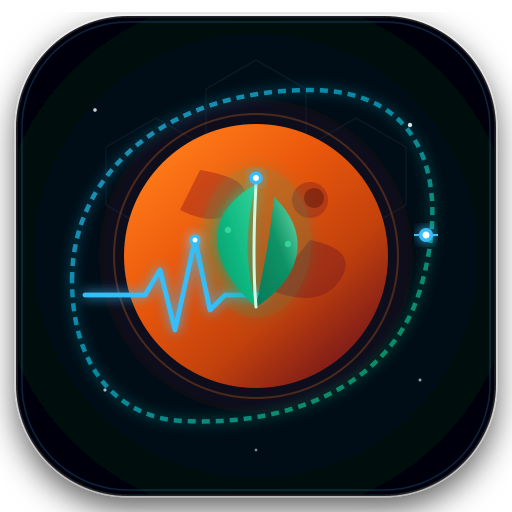

# NurtureAISpace

  
   
  <h2>NurtureAI Space — health monitoring for astronauts</h2>
  
NASA Space Apps 2026, challenge: <em>Create Health Monitoring Software for Astronauts on Space Missions</em>. Daily check-in app + crew dashboard + vitamin forecast. The live site shows a demo snapshot; source: <a href="https://github.com/NurtureAISpace/mars-food-intelligence">NurtureAISpace/mars-food-intelligence</a>.

  
<strong>Developed by Team NurtureAISpace</strong>

  

    <a href="https://nurtureaispace.github.io"><strong>Open the live demo »</strong></a>
  

---

### 👥 Team NurtureAISpace
* **Suleyman Hajizadeh** — Lead Systems Architect & Research ([`suleyman.hacizade1@gmail.com`](mailto:suleyman.hacizade1@gmail.com))
* **Banu Gurbanizada** — Frontend Architecture & UI/UX Design ([`banugurbanzade@gmail.com`](mailto:banugurbanzade@gmail.com))
* **Yunis Allahverdi** — AI/ML & Degradation Modeling ([`allahverdiyunis@gmail.com`](mailto:allahverdiyunis@gmail.com))
* **Faruk Karimli** — Computer Engineering & Life Support Simulation ([`fkarimli23291@ada.edu.az`](mailto:fkarimli23291@ada.edu.az))

---

### 🌐 Official Live Platform
- **Crew dashboard (demo snapshot):** [https://nurtureaispace.github.io](https://nurtureaispace.github.io)
- **Astronaut App (check-ins stay on the device):** [https://nurtureaispace.github.io/app/](https://nurtureaispace.github.io/app/)
- **Slides:** [/slides.html](https://nurtureaispace.github.io/slides.html)
- **Organization:** [https://github.com/NurtureAISpace](https://github.com/NurtureAISpace)
- **Core Technology:** First-principles Arrhenius degradation kinetics, SciPy linear constrained diet optimization, and a synthetic greenhouse model.
- **Lead Architect Contact:** Suleyman Hajizadeh (`suleyman.hacizade1@gmail.com`)

---

### Code, data sources and honesty notes
This is a research prototype (not a medical device) built for NASA Space Apps Challenge 2026, Ganja. Most scenarios are synthetic and are labeled as synthetic in the app.
- Main code: [`NurtureAISpace/mars-food-intelligence`](https://github.com/NurtureAISpace/mars-food-intelligence). If you cannot open it, contact `suleyman.hacizade1@gmail.com`.
- Every parameter and its source: `docs/DATA_SOURCES.md` in that repository.
- Real NASA data used: NASA OSDR OSD-569 and OSD-575 (Inspiration4). NASA publications are cited as references.
- Not all code was written during the hackathon; see "Built before vs during the hackathon" in that repository's README.

This public repository contains the static build of the app for the live site (built with `scripts/build_site.ps1` in the main repository). It reads a JSON snapshot of the API, so it runs without a server; live check-ins run in our laptop demo.
